# Mapa de funcionalidades do Realpolitik

Este mapa lista **todas as telas, botões e recursos visíveis** que o mod acrescenta ao Humankind, cada um com o print
de como ele está hoje. Serve para que nenhum botão suma ou mude de lugar sem ninguém perceber.

Prints em `docs\mapa\prints\`. Prefixos:
- `f_` = **estado final, referência atual** (depois da revisão de 2026-10-14). É com eles que se compara o jogo.
- `a_` = levantamento antes das correções; `b_` = correções intermediárias do mesmo dia. Ficam só para o antes → depois
  (seção [Correções da revisão de 2026-10-14](#correções-da-revisão-de-2026-10-14)) e onde ainda não há `f_`.
- `c_tip_` = tooltips da barra; `key_` = teste dos atalhos; `fix_` = teste do Relatar um problema; `de_` = conferência
  da interface em alemão.

Mapa sem nenhuma tela aberta (referência da barra e do HUD): 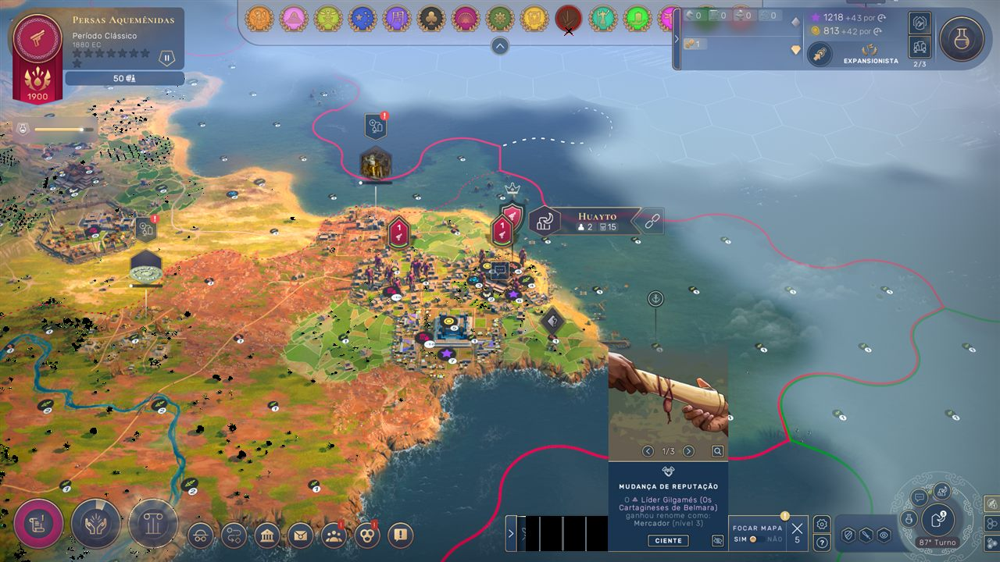

## Regra

> **Toda mudança que acrescenta, remove, renomeia ou muda de lugar um botão, aba ou tela atualiza este mapa no mesmo
> commit** (texto e, se a aparência mudou, o print). Se o mapa e o jogo discordam, um dos dois está errado: descubra
> qual antes de seguir.

### Checklist de reverificação (antes de cada release)

1. Carregar uma partida de teste com 16 jogadores (nunca o save real).
2. Conferir a barra de botões: os 5 botões na ordem certa, cada tooltip igual ao `c_tip_*`.
3. Testar cada atalho da tabela abaixo (abre; apertar de novo fecha; não abre com campo de texto em foco nem com o
   menu de pausa ou a tela Realpolitik aberta).
4. Abrir cada tela e cada aba deste mapa e comparar com o print: mesmas seções, mesmos botões, mesmos textos.
5. Abrir a diplomacia com uma nação: abas Relações (painéis Economia e Política externa), Comércio (Seus postos
   comerciais), Cartas; Inteligência → aba Cartas; Comercializar → Posto Comercial.
6. Menu de pausa e menu principal: botão Realpolitik presente.
7. Atualizar aqui o que mudou de propósito; o que mudou sem querer é bug.

## Atalhos de teclado

| Tecla | Abre | Config (`BepInEx\config\lucas.humankind.currency.cfg`) |
|---|---|---|
| F2 | Correio | `[IA] MailShortcut` |
| F3 | Alianças | `[IA] AlliancesShortcut` |
| F4 | Relatar um problema (seção da tela Realpolitik) | `[IA] ReportShortcut` |
| F6 | Realpolitik (tela da IA) | `[IA] RealpolitikShortcut` |
| F7 | Conselho | `[IA] CouncilShortcut` |
| F8 | Banco Central | `[Interface] AtalhoBancoCentral` |
| F10 | Visualizador de debug (dev, abre no navegador) | `[IA] AtalhoVisualizador` |

- Teclas que **não** podem ser usadas: o jogo usa F1, F5 (salvar rápido), F9 (carregar rápido) e Shift+F10; a Steam
  usa F12. (Um F9 antigo no Conselho é migrado sozinho para F7.)
- Os atalhos não abrem nada quando um campo de texto está em foco, nem com o menu de pausa ou uma tela do sistema
  (Configurações, Realpolitik) aberta. Ex.: F8 com a Realpolitik aberta não faz nada (`key_F8_blocked.jpg`).
- Apertar a tecla de uma tela que já está aberta fecha essa tela (`key_F*_closed.jpg`).
- Exceções: F10 só respeita o campo de texto (abre o visualizador até com o menu de pausa) e não fecha nada.
  F2, F3 e F7 não fazem nada no multijogador; F7 não faz nada com `[IA] ConselhoDoJogador = false`.
- Código: `src\CurrencyMod\NativeUI\NativeUIKit.cs` (`ShortcutPressed`, `ShortcutAllowed`).

Prints dos testes: `key_F2_mail.jpg`, `key_F3_alliances.jpg`, `key_F4_report.jpg`, `key_F6_realpolitik.jpg`,
`key_F7_council.jpg`, `key_F8_bank.jpg`, `key_0_clear.jpg` (sem nada aberto).

## Barra de botões (canto inferior esquerdo)

Os dois primeiros ícones são do jogo (Inteligência e Comercializar). O mod acrescenta, nesta ordem:

| # | Botão | Ícone | Abre | Selo (badge) | Aparece quando |
|---|---|---|---|---|---|
| 1 | **Banco Central (F8)** | prédio | Banco Central | "!" quando o diagnóstico da economia é ruim (alerta); some ao abrir a tela e só volta se o alerta mudar ou a crise acabar e voltar | em partida, fora do multijogador |
| 2 | **Correio diplomático (F2)** | envelope | Correio | número de cartas não lidas (1–9, "9+"); "X" quando nenhum provedor de IA responde | em partida, fora do multijogador |
| 3 | **Conselho (F7)** | pessoas | Conselho | "!" quando a reunião do turno está pronta e não vista, ou há assunto urgente | em partida, fora do multijogador e com `[IA] ConselhoDoJogador = true` |
| 4 | **Alianças (F3)** | três círculos | Alianças | "!" com convite, voto faltando, eleição ou sugestão para o presidente | em partida, fora do multijogador (sempre; ver nota) |
| 5 | **Relatar um problema (F4)** | "!" em balão | seção Relatar um problema da tela Realpolitik | — | em partida, fora do multijogador |

Nota: o botão Alianças **sumia** quando a IA estava desligada no momento de carregar a partida. Corrigido em
2026-10-14: agora aparece sempre.

O botão da tela aberta vira um "X" na barra (ver `f_bank_0.jpg`). As telas do mod são exclusivas: abrir uma fecha as
outras (`NativeUI\ExclusiveWindows.cs`). A ordem da barra vem da ordem de criação em `Plugin.cs` (cada botão novo vai
para o fim): um botão criado mais tarde (ex.: Conselho ligado no meio da partida) aparece no fim.

Código: `NativeUI\NativeBankButton.cs`, `Diplomacy\UI\MailButton.cs`, `Diplomacy\UI\CouncilButton.cs`,
`Diplomacy\UI\AlliancesButton.cs`, `Support\ReportButton.cs`.

| Banco Central | Correio | Conselho |
|---|---|---|
| 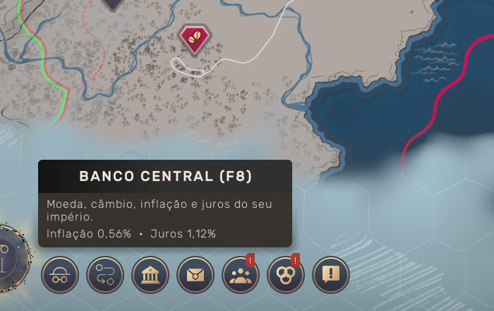 | 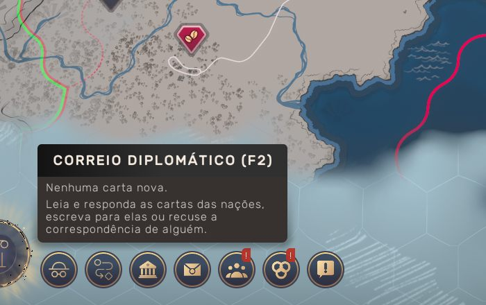 | 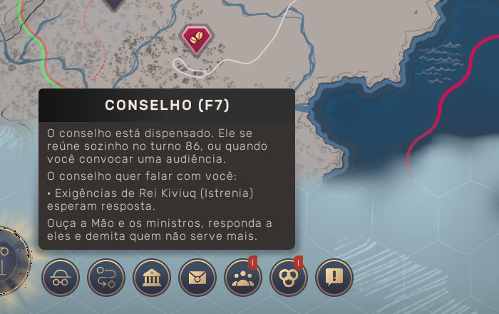 |
| **Alianças** | **Relatar um problema** | |
| 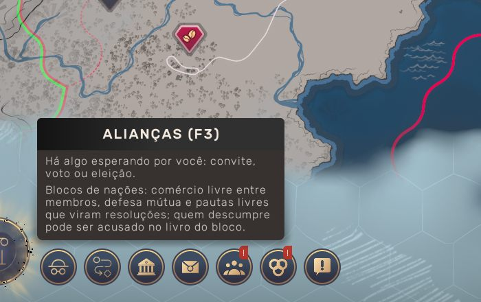 | 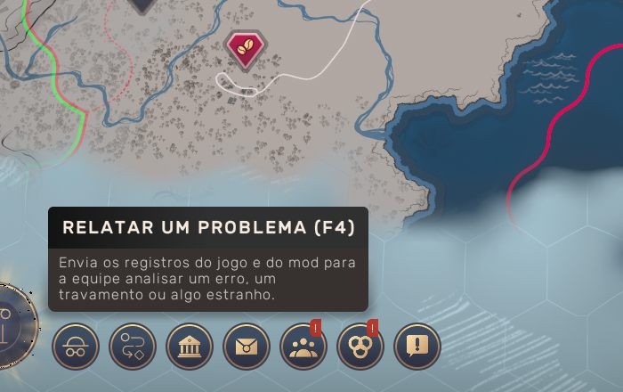 | |

Tooltips:
- **Banco Central (F8):** "Moeda, câmbio, inflação e juros do seu império." + linha com inflação e juros atuais; com
  alerta, "Alerta: … Veja o diagnóstico na aba Ciclo."
- **Correio diplomático (F2):** "Nenhuma carta nova." / "N cartas novas.", comunicados que citam você, aviso "IA
  desconectada" quando for o caso + "Leia e responda as cartas das nações, escreva para elas ou recuse a
  correspondência de alguém."
- **Conselho (F7):** estado da reunião (dispensado / se reúne sozinho no turno N / pronta / falhou / se reunindo),
  respostas esperando, o que o conselho quer falar + "Ouça a Mão e os ministros, responda a eles e demita quem não
  serve mais."
- **Alianças (F3):** "Há algo esperando por você: convite, voto ou eleição." (quando há) + "Blocos de nações: comércio
  livre entre membros, defesa mútua e pautas livres que viram resoluções; quem descumpre pode ser acusado no livro do
  bloco."
- **Relatar um problema (F4):** "Envia os registros do jogo e do mod para a equipe analisar um erro, um travamento ou
  algo estranho." + estado do último envio (código, falhou, enviando).

---

## Banco Central

Código: `src\CurrencyMod\NativeUI\NativeBankWindow.cs` (+ `NativeBankTrade.cs`, `NativeBankResources.cs`,
`BankChart.cs`). Dev: `nbank open | close | tab N` (0 Câmbio … 5 Sua moeda).

Tela nativa com menu de abas à esquerda, conteúdo no meio e **Visão geral** fixa à direita. Embaixo à esquerda:
**Voltar ao jogo** (ESC e o botão do banco também fecham).

**Visão geral (coluna direita, em todas as abas):** Saldo (renda por turno, inflação, juros, câmbio e seta),
Diagnóstico (ex.: "Economia equilibrada"), Sua posição no mundo (posição da moeda e da inflação, moeda mais forte e
mais fraca, fatia do PIB), Ranking das moedas: posição numerada e nome curto do território ("1. Ostmaria"), com a sua
linha ("11. Você", em dourado) sempre visível no fim.

| Aba | Conteúdo | Botões / controles | Print |
|---|---|---|---|
| **Câmbio** | "Câmbio com os impérios que você conhece": gráfico "Sua moeda nos últimos 60 turnos" (você, outros, média do mundo) e um cartão por império (cotação, inflação, juros, moeda, PIB) | no topo: **Ordenar por cotação**, **Ordenar por inflação**, **Ordenar por juros**, **Crescente / decrescente** (▼) | 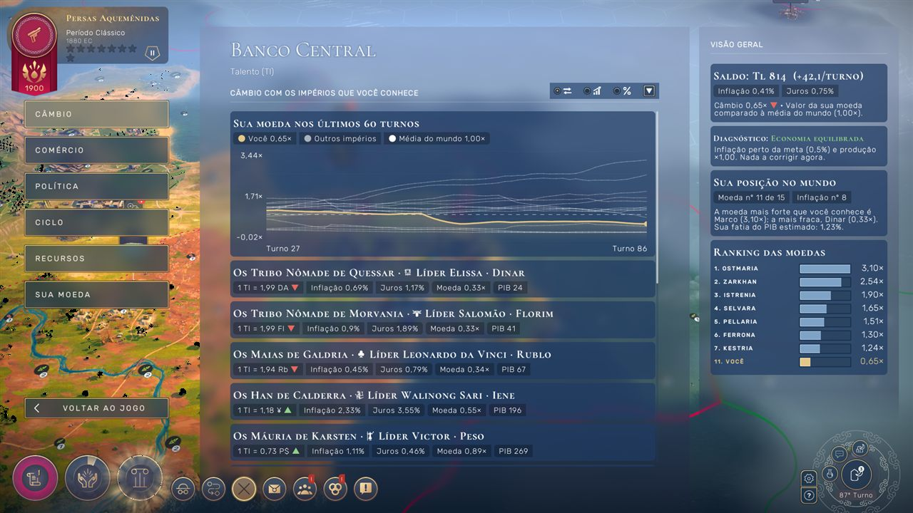 |
| **Comércio** | "Dinheiro que entra e sai com cada império": gráfico (você paga / ganha / saldo) e um cartão por parceiro com barras "Você paga" / "Você ganha" (tooltip com o detalhamento) | — | 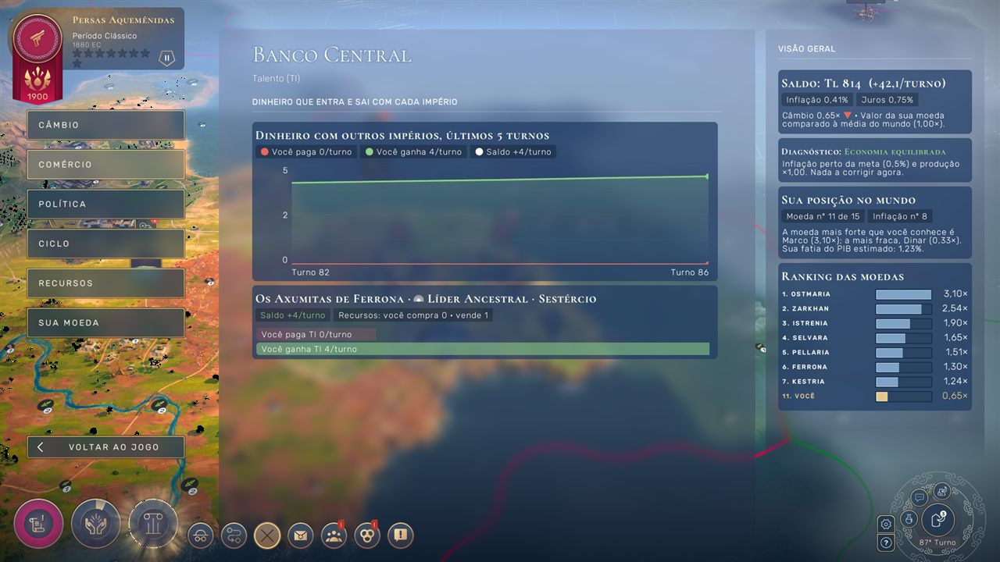 |
| **Política** | "Política monetária": gráfico inflação × juros × meta, cartão "Juros: X%/turno · automático/manual", **Ajustar juros**, cartão Inflação (meta, preços, neutro) | botão **Mudar para manual** / **Mudar para automático**; slider **Ajustar juros** (mexer passa para manual) | 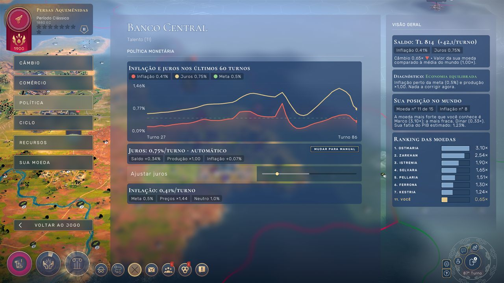 |
| **Ciclo** | "Ciclo econômico": gráfico, Diagnóstico, 1 · Oferta × demanda, 2 · Inflação → juros, 3 · Juros → produção, Estabilidade, Rendimento do saldo / Custo da dívida, Rumo da inflação | — (só leitura, com rolagem) | 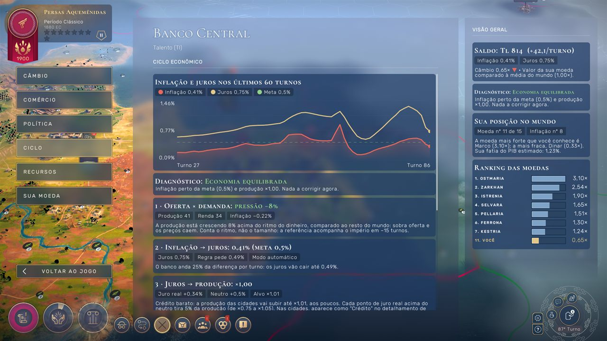 |
| **Recursos** | "Recursos do seu império": gráfico de acessos (eixo 0, 1, 2) e um cartão por recurso (acessos, tipo, de onde vem / para quem vende) | — | 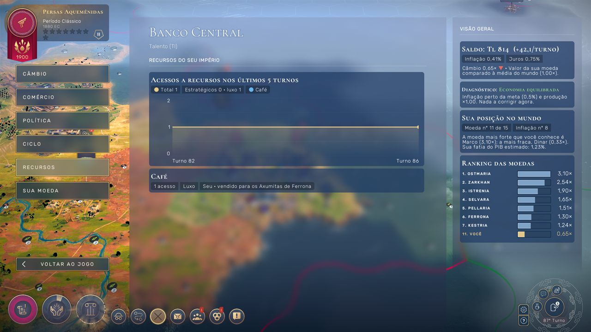 |
| **Sua moeda** | Nome da moeda, Plural, Símbolo (campos editáveis) e prévia "Exemplo: custa 500 Talentos" / "Exemplo de saldo" | botão **Salvar** (Enter num campo também salva) | 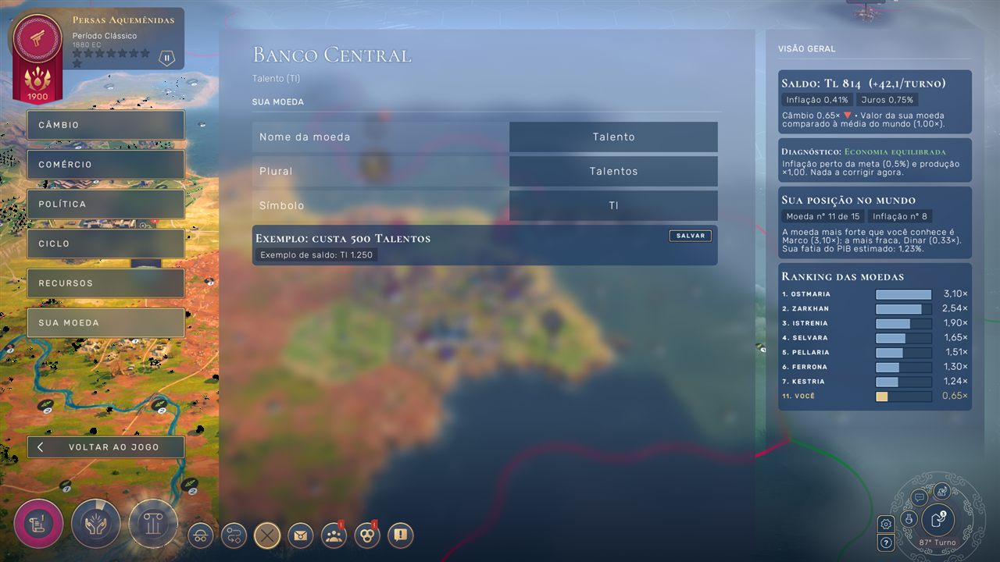 |

Existe ainda a janela antiga (IMGUI, `CentralBankWindow.cs`), usada só se a nativa não existir, e o botão de moeda
flutuante (`[Interface] BotaoMoeda`). Dev: `bank open | close | tab 0-3`.

---

## Correio

Código: `src\CurrencyMod\Diplomacy\UI\MailScreen.cs`.
Dev: `ai mail open | close | section N (0..7) | to E# | reply [id] | type ... | send`.

Cabeçalho: "Turno N. Suas cartas chegam em X turnos (mensageiro)." Filtros no topo da lista: **Nação: todas** (cada
clique passa para a próxima nação) e **Período: tudo** (tudo / últimos 5, 15, 30 turnos). Embaixo à esquerda:
**Voltar ao jogo**. Abre em Novas.

**Coluna Escrever (direita, em todas as seções):**
- **Para:** destinatário, botão **Trocar** (passa para a próxima nação); mostra quando a carta chega e a relação.
- Tipo da carta, botão **Próximo tipo** passa pelos cinco: **Carta privada** ("Só o destinatário lê"), **Ultimato** (exigência com
  prazo; chega mesmo se recusarem suas cartas), **Declaração pública**, **Mensagem de grupo**, **Trato** (carta que
  registra um acordo).
- **Em resposta a** com botão **Carta nova** quando é resposta (desfaz a ligação e vira carta nova; antes "Soltar").
- Assunto (opcional), corpo da carta; campos extras do Ultimato ("O que você exige") e do Trato ("O que você dá" /
  "O que ele dá"), com o prazo.
- **Escreva a carta acima / Pronta para enviar**, contador "0/2000 caracteres", botão **Enviar**.

| Seção | O que lista | Botões em cada cartão | Print |
|---|---|---|---|
| **Novas** | cartas ainda não lidas (as lidas continuam na lista até o fim do turno; no turno seguinte saem) | **Na diplomacia** (abre a aba Cartas da nação), **Responder** | 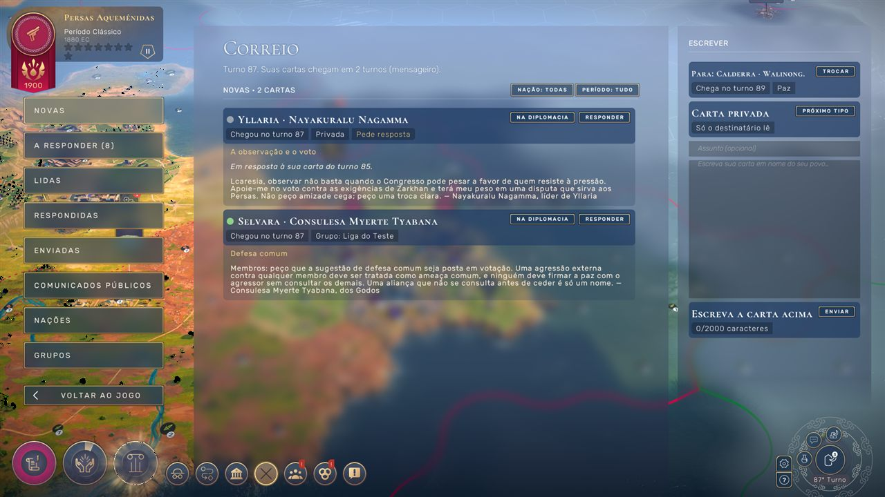 |
| **A responder (N)** | cartas e ultimatos que pedem resposta | Na diplomacia, Responder | 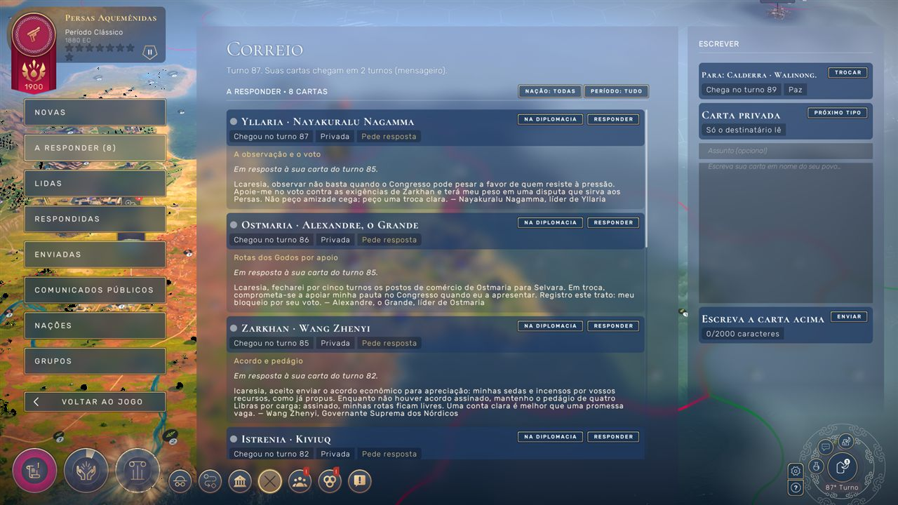 |
| **Lidas** | cartas recebidas já lidas | Na diplomacia, Responder | 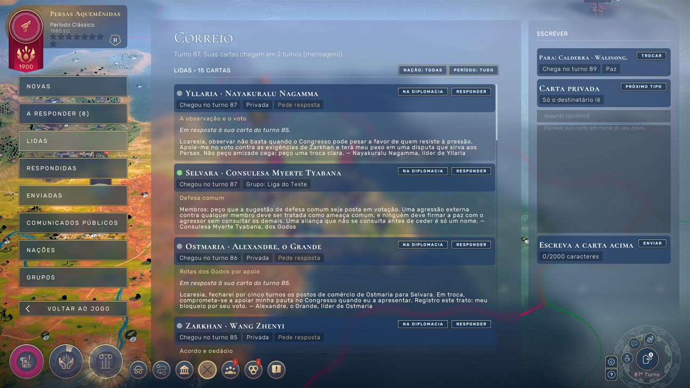 |
| **Respondidas** | cartas que você já respondeu | Na diplomacia, **Escrever de novo** | 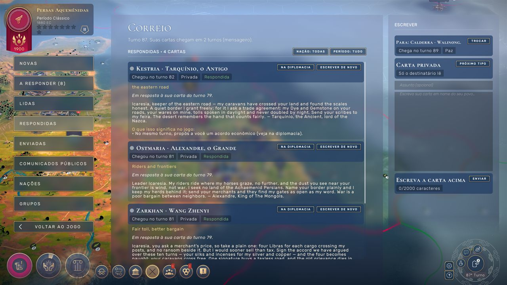 |
| **Enviadas** | suas cartas, com estado (a caminho, entregue, lida, respondida, recusada) | — | 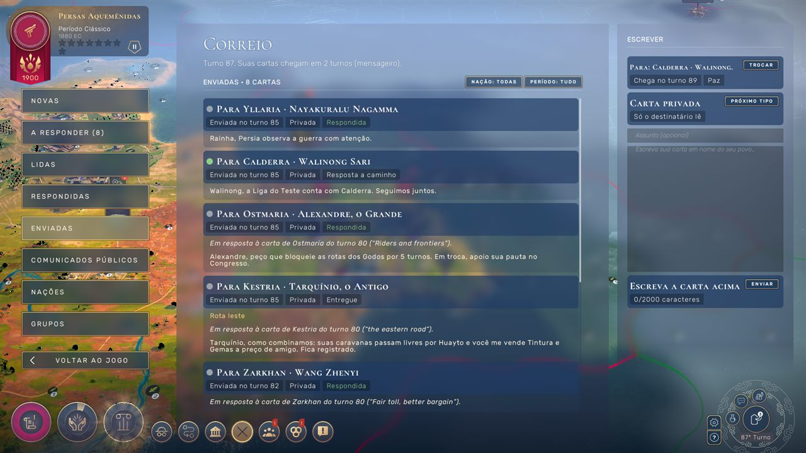 |
| **Comunicados públicos** | cartas "a todos" (a aba mostra quantos citam você) | Na diplomacia, Responder | 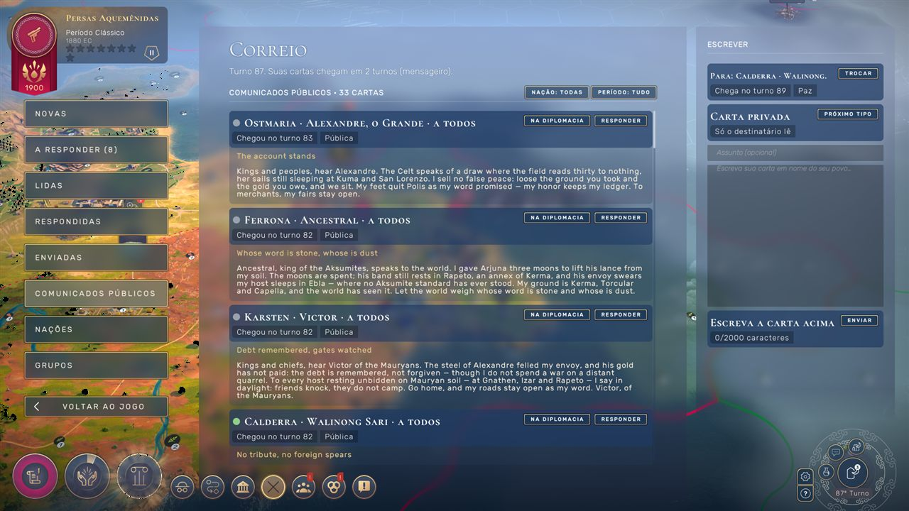 |
| **Nações** | nações conhecidas, com relação e recebidas/enviadas | **Recusar cartas** / **Aceitar cartas**, **Escrever** (vira **+ Grupo** / **No grupo** ao montar um grupo novo) | 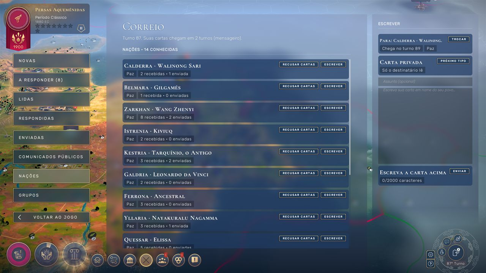 |
| **Grupos** | conversas com várias nações (membros, mensagens, quem criou, última mensagem) | **Sair** (pede confirmação no 2º clique), **Escrever**; cartão **Criar outro grupo** (ou "Você ainda não está em nenhum grupo") com botão **Criar um grupo** | 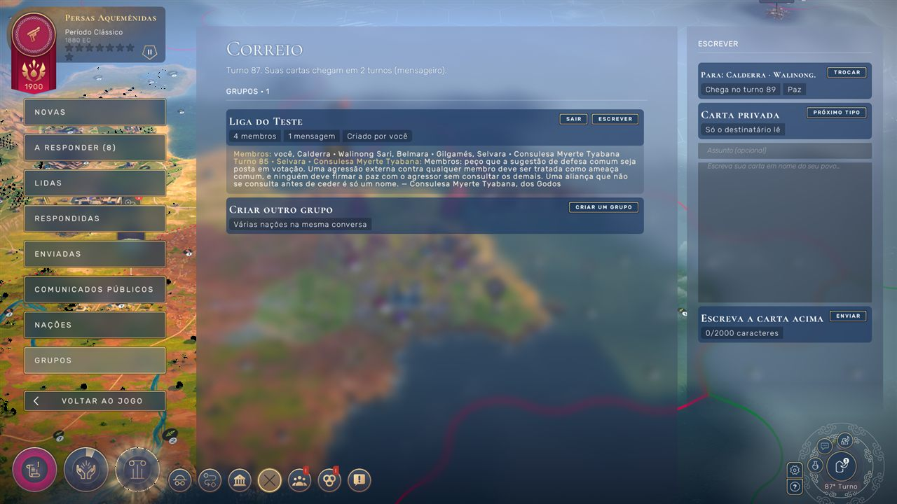 |

O cartão **Criar outro grupo / Criar um grupo** precisa estar sempre lá, mesmo com grupos já criados (ele sumia antes da
revisão; ver correções).

Cartas da IA podem trazer o bloco **"O que isso significa no jogo:"**, que traduz a carta no que a nação fez.

---

## Conselho

Código: `src\CurrencyMod\Diplomacy\UI\CouncilScreen.cs` (+ `Diplomacy\Council\PlayerCouncil.cs`).
Dev: `ai council show | open | close | section 0..2 | speak <texto> | convene`.
Desligado com `[IA] ConselhoDoJogador = false` (o botão some e a tela avisa que está desligado no .cfg).
`[IA] ConselhoAbreSozinho = true` abre a tela sozinha uma vez por turno quando a reunião fica pronta e o mapa está livre.

Cabeçalho: "Turno N. X conselheiro(s)." e "Última reunião: turno N • a próxima é no turno M, ou quando você convocar".
Embaixo à esquerda: **Voltar ao jogo**.

**Coluna Falar ao conselho (direita):**
- Estado ("O conselho está dispensado", turno, "Sozinho no turno N").
- Campo de texto (pergunte a um ministro pelo nome ou pela pasta, ou dê uma ordem; até 120 palavras).
- Nomear ou demitir um ministro: o resultado aparece por 8 s no título "Ministros · …" (não nos cartões de falar/convocar).
- Sem reunião no turno: **Peça uma audiência** com botão **Convocar** (custo "1 chamada à API").
  Com reunião: botão **Falar** (até 8 falas por turno). Reunião que falhou: **Convocar de novo**.
- **Reuniões automáticas** com botão **Mudar** (passa por automático, 3, 5, 7, 10, 15, 20 turnos e "Só por audiência").

| Seção | Conteúdo | Botões | Print |
|---|---|---|---|
| **Reunião do turno** | "O conselho quer falar com você", Resumo do conselho, fala da Mão do Trono, uma seção por pasta | — | 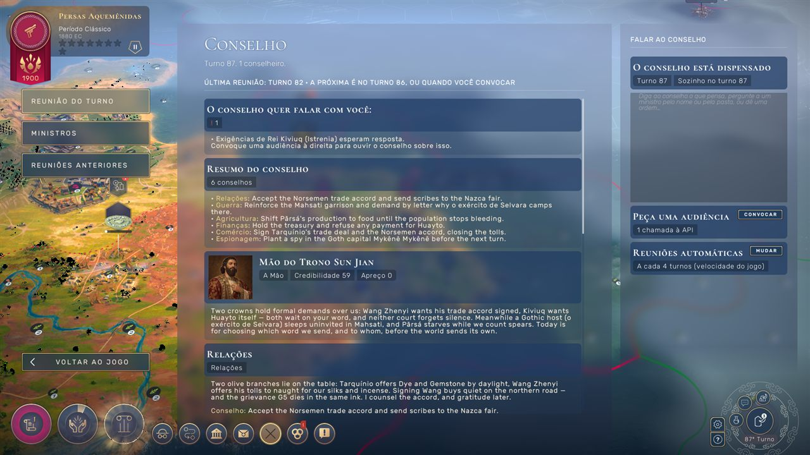 |
| **Ministros** | "N no cargo • N pastas vagas"; cartão de cada ministro (traços, voz, lealdade, ambição, simpatias, números da pasta) e de cada pasta vaga (custo de nomear e bônus) | **Demitir** (vira **Confirmar** por 5 s; o segundo clique demite); **Escolher** / **Fechar** na pasta vaga (mostra 3 candidatos, cada um com **Nomear · custo**). A lista muda na próxima era e, até lá, a cada ~10 turnos (ajustado pela velocidade do jogo) um candidato cansa de esperar e outro entra; o cartão da pasta mostra quem saiu e quem entrou, e a reunião do turno anota a troca | 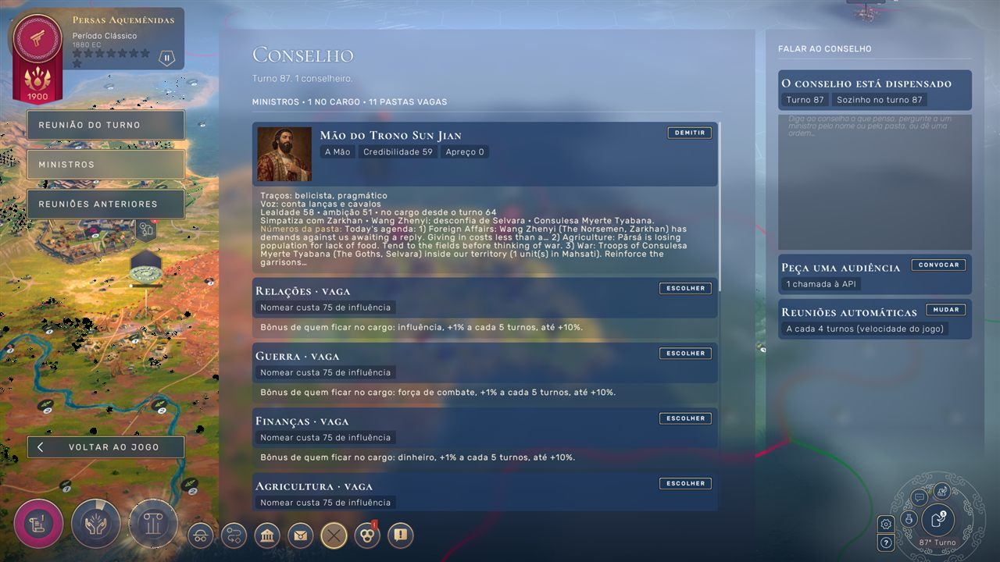 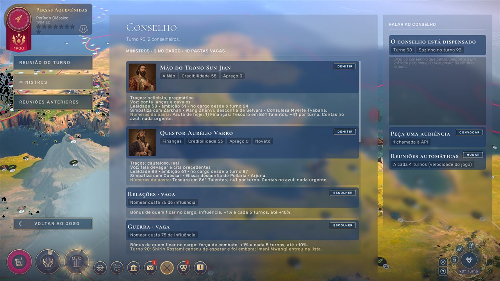 |
| **Reuniões anteriores** | as últimas 12 reuniões, com falas e conselhos | — | 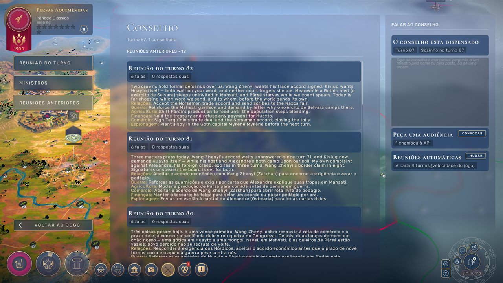 |

As falas usam nomes, nunca códigos internos ("Huayto", "o exército de Selvara"; não T29, A99, C18).

---

## Alianças

Código: `src\CurrencyMod\Diplomacy\UI\AlliancesScreen.cs` (+ `Diplomacy\Blocs\*`).
Dev: `ai alliances open | close | section N (0..5) | text ... | invite E# | send`; lógica: `ai bloc ...`.

Cabeçalho: "Turno N. <bloco> • N membros • presidente: …". Embaixo à esquerda: **Voltar ao jogo**.

**Coluna direita** (muda com a situação):
- **Sem bloco — Fundar um bloco:** nome do bloco, um cartão por nação com **+ Convidar** / **Convidado**, botão
  **Fundar**.
- **Bloco em formação:** membros e convites abertos, botão **Desistir** (pede **Confirmar**).
- **Bloco formado — Pôr em votação** (presidente) ou **Sugerir ao presidente**: **Pauta livre** ("Vai direto à
  votação" / "Vira sugestão", contador de pautas), campo de texto, **Pronta** com botão **Pôr em votação** / **Sugerir**
  ("Votação de 2 turnos"), **Sair do bloco** com botão **Sair** (pede **Confirmar**; "Espera de 10 turnos").
- **Seção Congresso mundial — Propor ao Congresso:** Pauta livre no Congresso ("Vira sugestão", pautas),
  campo de texto, **Pronta** ("Votação de 2 turnos", "Preside: <nação>") com botões **Acusar** e **Sugerir** (**Pôr em votação** se você preside).

| Seção | Conteúdo | Botões | Print |
|---|---|---|---|
| **Meu bloco** | cartão do bloco (fundação, presidente, mandato, membros), Comércio interno, Defesa mútua, Resoluções em vigor ("Resolução 1 «…», até o turno N"), Livro do bloco, um cartão por membro | **Conversa do bloco** (abre o Correio no grupo do bloco); no cartão de cada membro **Acusar** (usa o texto da coluna direita, começando com "Resolução N:"; pede confirmação no 2º clique) e **Expulsão** | 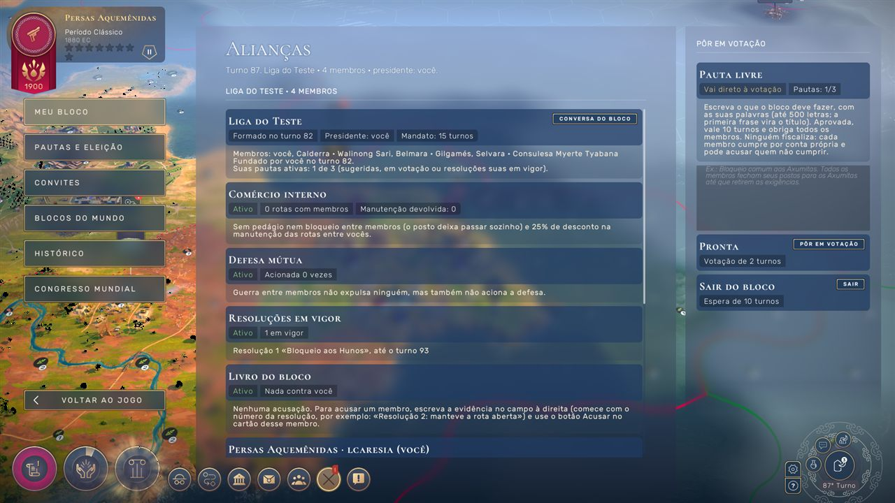 |
| **Pautas e eleição** | resoluções em vigor ("Resolução 1"), pautas em votação, sugestões dos membros ("Expira no turno N"), eleição | sugestões: **Descartar**, **Pôr em votação** (presidente); pauta aberta: **Sim** / **Não**; empate: **Aprovar** / **Rejeitar** (presidente); eleição: **Votar** | 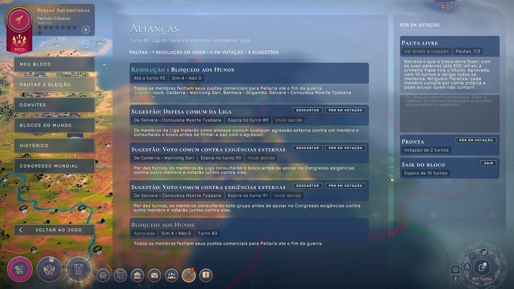 |
| **Convites** | convites para você e enviados ("Nenhum convite" quando vazio; o convite fica 5 turnos) | **Aceitar** / **Recusar** no convite recebido | 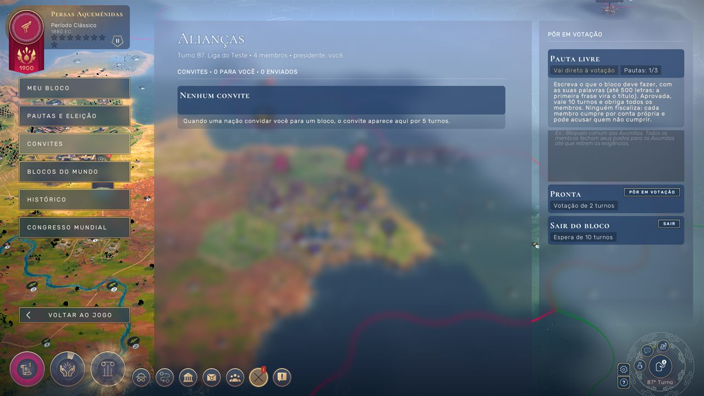 |
| **Blocos do mundo** | todos os blocos (membros, presidente, fama e força somadas, resoluções) | — | 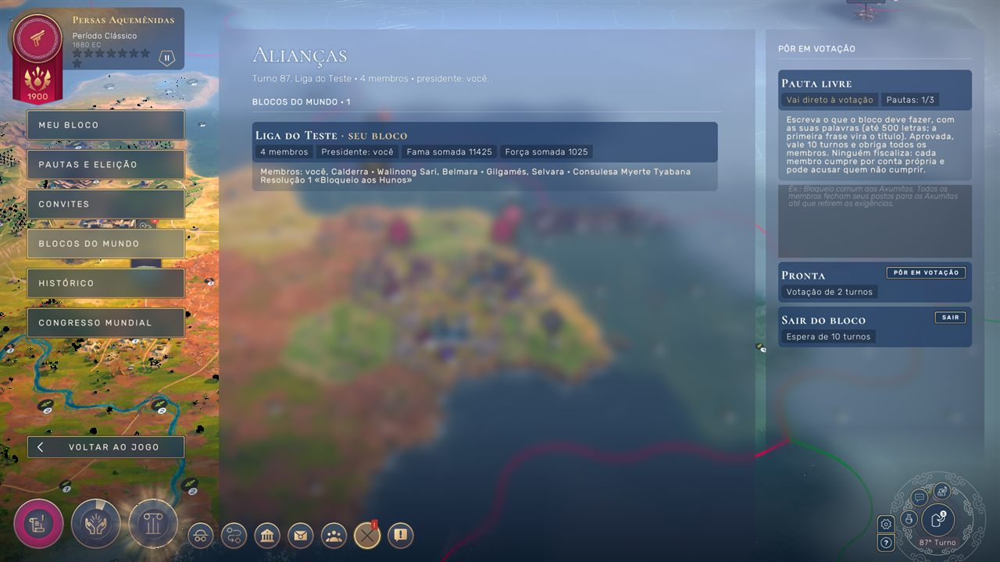 |
| **Histórico** | acontecimentos por turno (fundou, entrou, sugeriu, aprovada, "X descumpriu: …" em vermelho) | — | 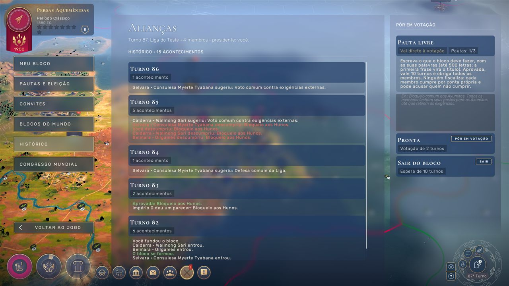 |
| **Congresso mundial** | pautas do Congresso ("Resolução 2 …", a favor / contra / não votou), sugestões ("Aguarda o presidente") | Acusar (texto começa com o nome da nação), Sugerir (coluna direita) | 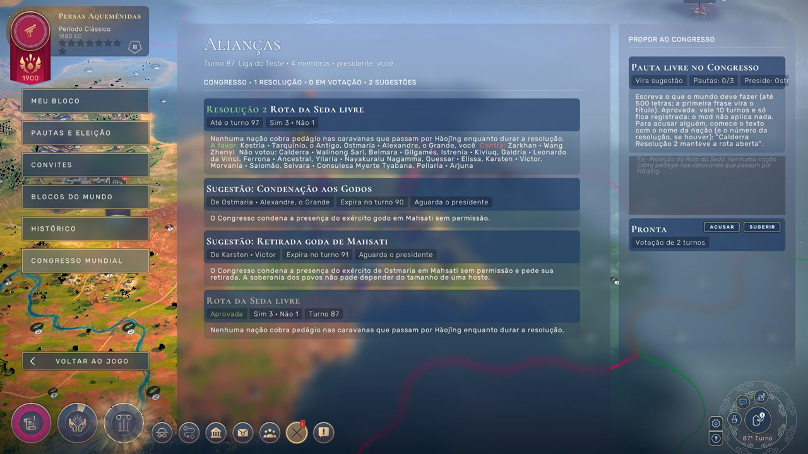 |

---

## Realpolitik (tela da IA)

Código: `src\CurrencyMod\Diplomacy\UI\ProvidersScreen.cs`; botões dos menus: `Diplomacy\UI\ProvidersButtons.cs`;
relatório: `Support\ErrorReport.cs`, `Support\ReportButton.cs`.
Dev: `ai provider screen open [id|usage] | close | section <id>` (seção do relatório: id `#report`); enviar relatório
sem abrir tela: `game report [nota]`.

Tela do sistema (como Configurações). Cabeçalho "Realpolitik — Escolha onde as nações do computador pensam. Nada de
editar arquivos." Menu à esquerda: Em uso, os oito provedores (OpenRouter, ChatGPT (Codex), DeepSeek, OpenAI, Google
Gemini, GLM (Z.ai), xAI (Grok), Ollama / LM Studio), cada um com o estado (Conectado / Não conectado / Sem chave /
Com erro) e a posição na fila ("1º", "2º"), e por último **Relatar um problema** (estado do último envio).

Botão de voltar embaixo à esquerda, conforme de onde foi aberta:
- pela barra ou por atalho (F4/F6): **Voltar ao jogo**, e fechar volta direto ao mapa (`f_report`, `f_back_to_map`);
- pelo menu de pausa: **Menu do jogo** (volta ao menu de pausa);
- pelo menu principal: **Menu principal** (`b_mainmenu_prov`).

Aberta pela barra, ela é uma tela do sistema: esconde o HUD e não empilha com o Banco Central nem com outra tela.
O item **Em uso** do menu mostra **"IA desligada"** (em vermelho) quando a IA das nações está desligada.

| Seção | Controles | Print |
|---|---|---|
| **Em uso** | texto "Agora: … / Fila: … / Gasto nesta partida"; listas **IA das nações** (Ligada/Desligada, grava `[IA] Ativo`), **Teto de gasto por partida**, **Nações que pensam por turno**, **Idioma das cartas**, **Raciocínio do modelo**; aviso do que sai do PC | 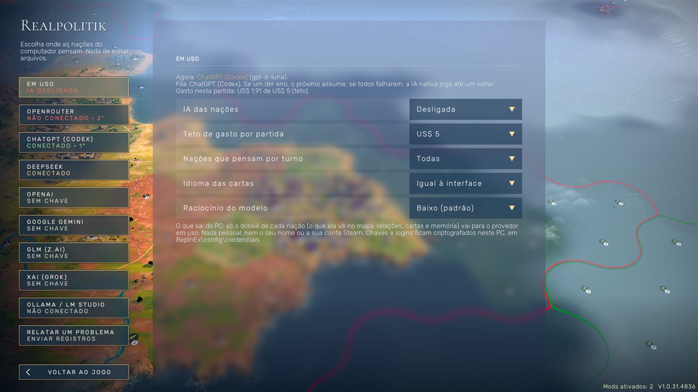 |
| **OpenRouter** (igual para DeepSeek, OpenAI, Google Gemini, GLM, xAI) | **Na fila** (Não usar / 1º: principal / Nº: reserva), **Entrar com a conta** → **Entrar** (só onde há login), **Chave de API** (campo, Enter salva), **Colar a chave copiada** → **Colar**, **Modelo** (lista com preço), **Testar conexão** → **Testar**, **Site do provedor** → **Abrir site**; com chave ou login salvo também **Apagar a chave** / **Sair desta conta** (pede **Confirmar**) | 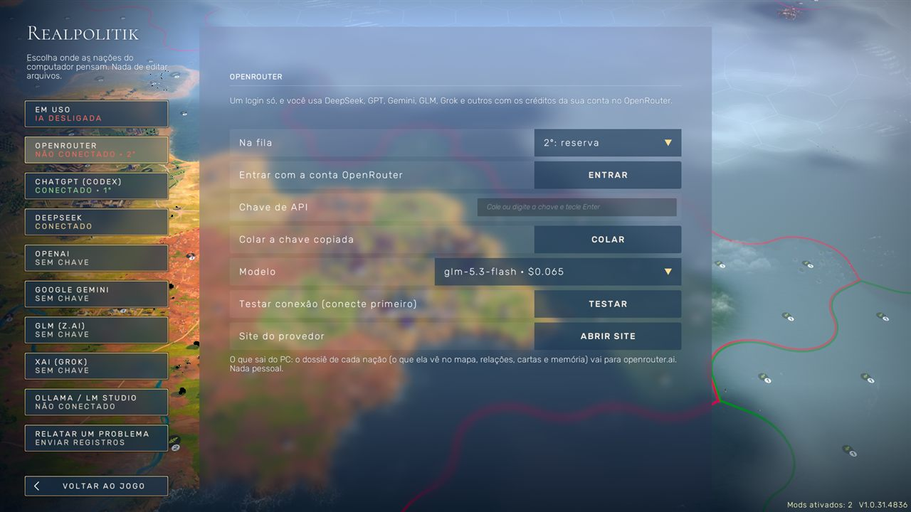 |
| **ChatGPT (Codex)** | Na fila, **Conta conectada** → **Entrar de novo** (ou **Instalar** sem o Codex), Modelo, Testar conexão → Testar, **Site do Codex** → Abrir site | 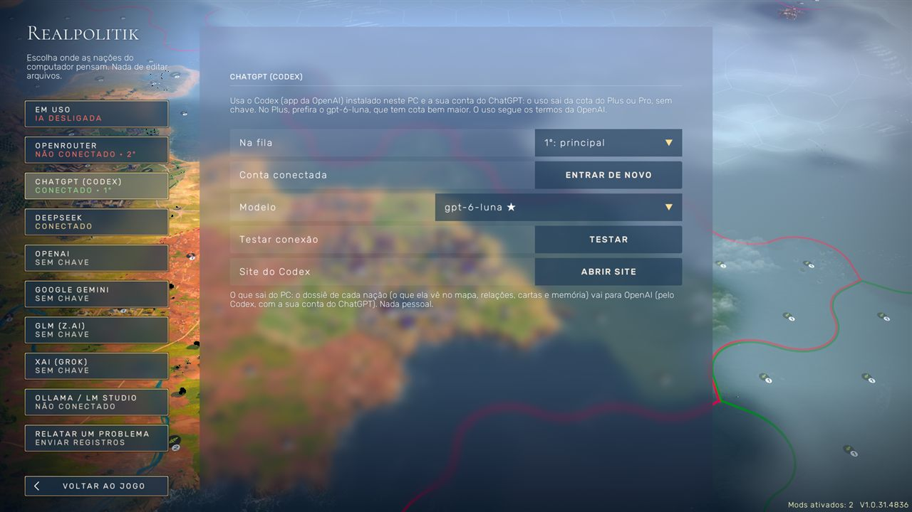 |
| **Ollama / LM Studio** | Na fila, Modelo, Testar conexão → Testar, Site do provedor → Abrir site | 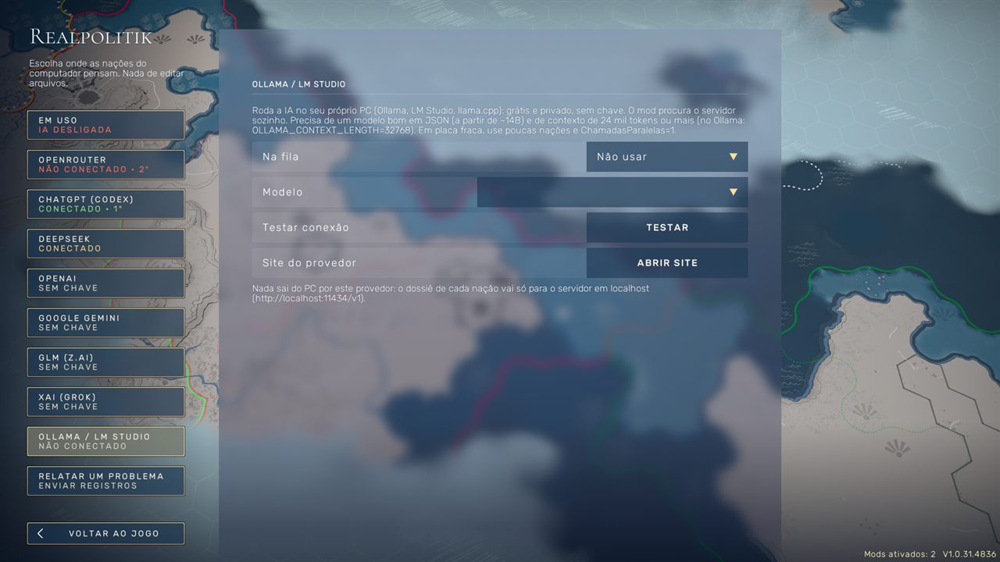 |
| **Relatar um problema** | **O que aconteceu?** (campo), **Enviar os registros para análise** → **Enviar** (depois mostra o código; **Enviar de novo**), **Pasta dos relatórios salvos** → **Abrir**; texto do que é enviado | 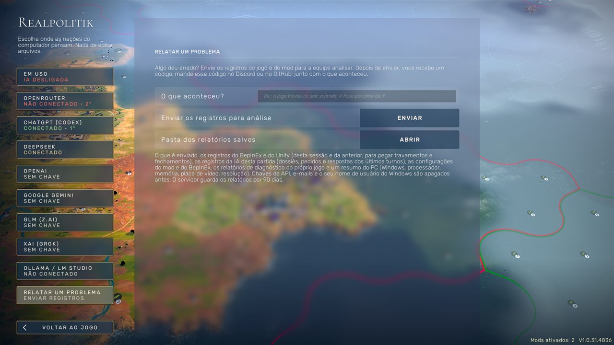 |

Fechar com **Voltar ao jogo** volta ao mapa: 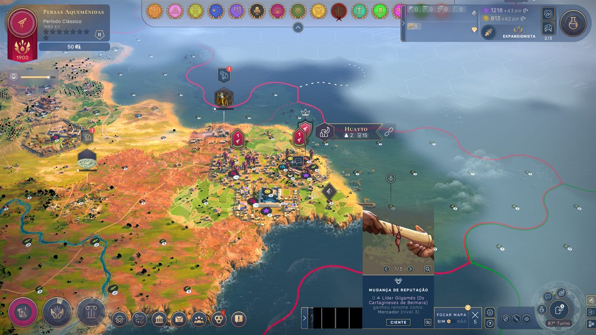

Outros prints: `key_F8_blocked.jpg` (relatório aberto; F8 não abre o banco por cima), `fix_report_closed.jpg`;
`fix_report_then_bank.jpg` é o defeito antigo (empilhava com o banco).

### Onde a Realpolitik é aberta

- **Menu de pausa:** botão **Realpolitik** logo abaixo de Configurações (tooltip "Realpolitik (F6)" — "Conecte a IA
  que faz as nações do computador pensarem, escreverem cartas e negociarem: login ou chave, modelo e limites.").
  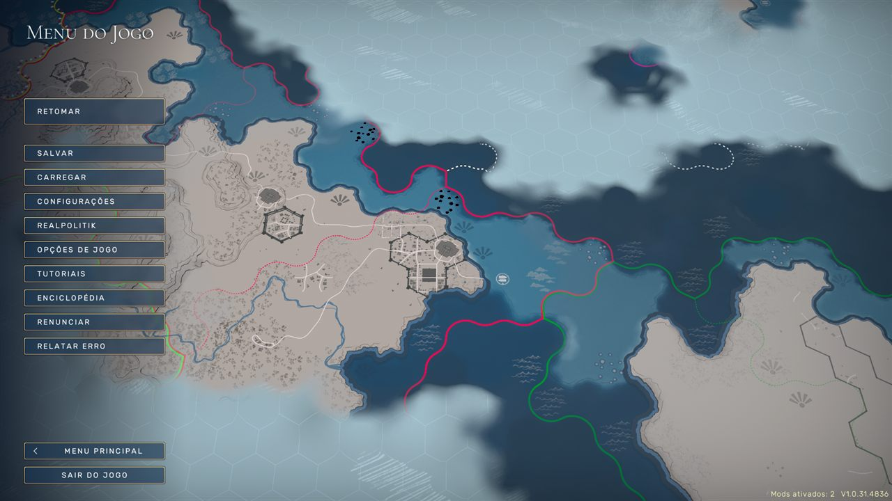

  > **Observação:** o botão **Relatar erro** desse menu é **do jogo** e manda para a Amplitude, não para a equipe do
  > mod. O nosso é **Relatar um problema** (barra, F4 ou seção da tela Realpolitik).
- **Menu principal:** botão **Realpolitik** entre Cenários e Extras, com o tooltip "Realpolitik — Conecte a IA que faz
  as nações do computador pensarem, escreverem cartas e negociarem: login ou chave, modelo e limites." Abre a tela com
  o botão **Menu principal** embaixo.

  | Botão | Tooltip | Tela aberta (atual) |
  |---|---|---|
  |  | 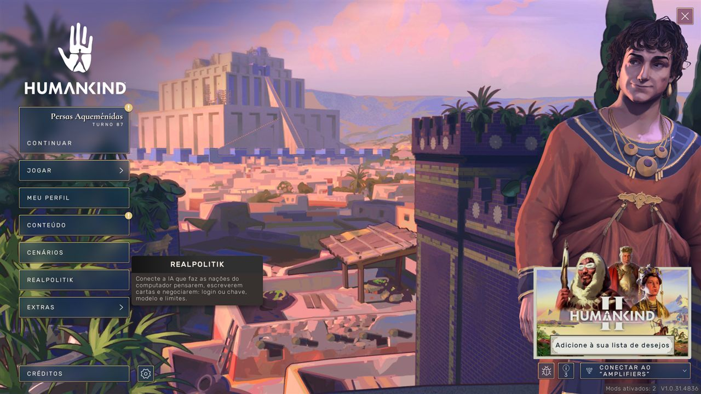 | 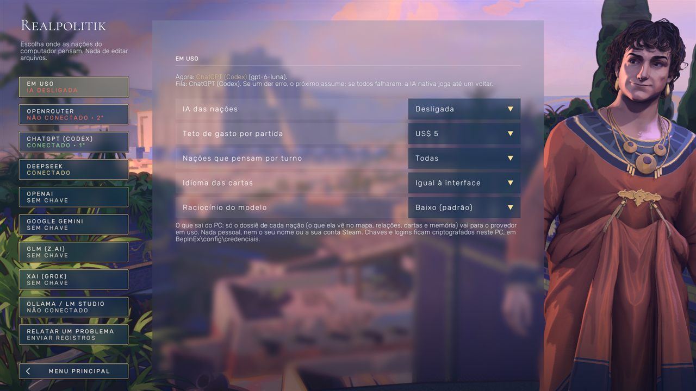 |
- Barra (botão Relatar um problema, abre na seção do relatório), F6 (tela toda) e F4 (seção do relatório).

---

## Diplomacia nativa (acréscimos do mod)

Abrir a diplomacia com uma nação pelo retrato. Dev: `game interaction diplomacy E#` e
`tab relations|trade|treaties|crisis`; `ai letters E#` abre direto na aba Cartas.

### Aba Relações — painéis Economia e Política externa

Código: `src\CurrencyMod\NativeUI\DiplomacyEconomyPanel.cs`.

- **Economia:** moeda deles e câmbio ("1 Tl = 0,27 £ • A moeda deles vale mais: importar deles sai caro") e barras
  comparando você × eles: PIB estimado, Renda por turno, Força da moeda, Inflação por turno, Juros por turno.
- **Política externa:** Doutrina (o papel que a nação busca), Como vê você (a leitura da IA dela sobre você), Blocos.
  Texto atual neutro de gênero: "Doutrina:", "Como vê você:".

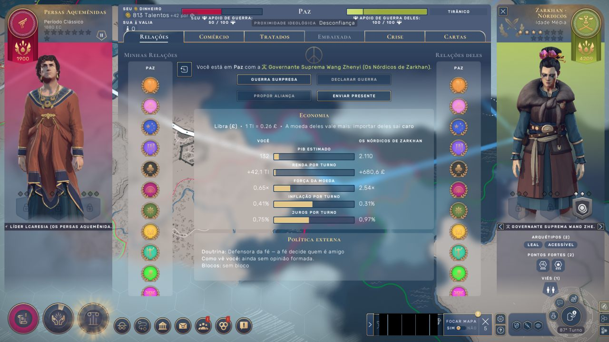

### Aba Comércio — Seus postos comerciais

Código: `src\CurrencyMod\NativeUI\DiplomacyTradePolicyPanel.cs` (some com `[BloqueioComercial] Ativo = false`).
Abaixo de "Seus recursos": **Seus postos comerciais** com o efeito nas rotas dessa nação nos seus territórios, os
botões **Livre**, **Taxar**, **Bloquear** (o ativo aparece com ✓; bloquear dá a eles uma reclamação "Bloqueio
comercial"), o pedágio ("Pedágio: Tl 4 por recurso (padrão)") com **−** / **+**, e o resumo ("Livre em todos os 4
postos"). Com muitos recursos a caixa "Seus recursos" cresce e o bloco desce junto, logo abaixo dela; a aba (e o
fundo azul da tela) cresce até caber o bloco, porque o conteúdo da aba corta o que passa da altura nativa (patch em
`DiplomaticTradePanel.RefreshHeight`).

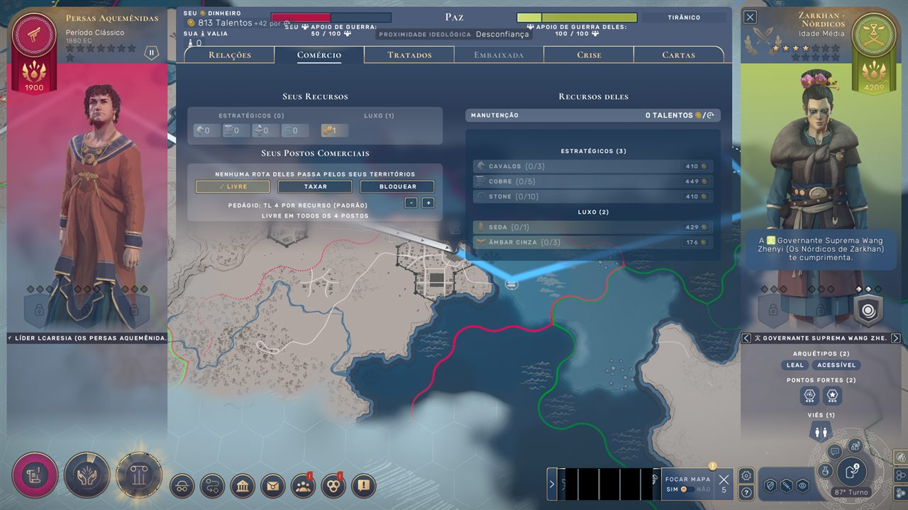

### Aba Tratados

Do jogo, sem mudança do mod (referência): 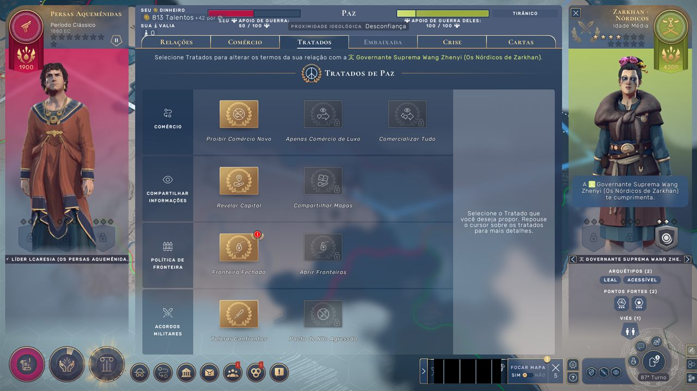

### Aba Crise

Tela do jogo (reclamações e exigências; Exigir tudo / Renunciar a tudo). O mod não acrescenta botões aqui, mas
acrescenta a reclamação **"Bloqueio comercial em …"** com os textos dela e a nota "Se a exigência for aceita, os
bloqueios e pedágios contra quem exigiu são retirados." (`Trade\TradeGrievances.cs`).
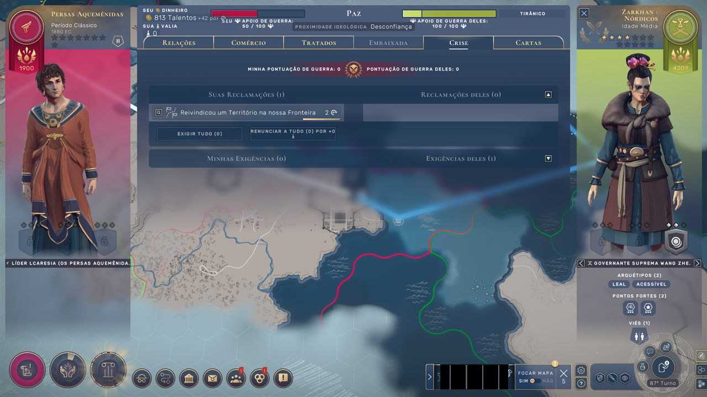

### Aba Cartas

Código: `src\CurrencyMod\Diplomacy\UI\CorrespondenceTab.cs`. Aba nova **Cartas** (com selo de cartas novas dessa
nação): "Correspondência com <nação>" (todas as cartas trocadas com ela, das duas partes) e, à direita, a caixa de
escrever: **Carta privada** / **Ultimato** (botão **Próximo tipo**), "Re: <assunto>" com **Carta nova** (desfaz a
resposta), assunto, texto, exigência e prazo (ultimato), contador e **Enviar**.

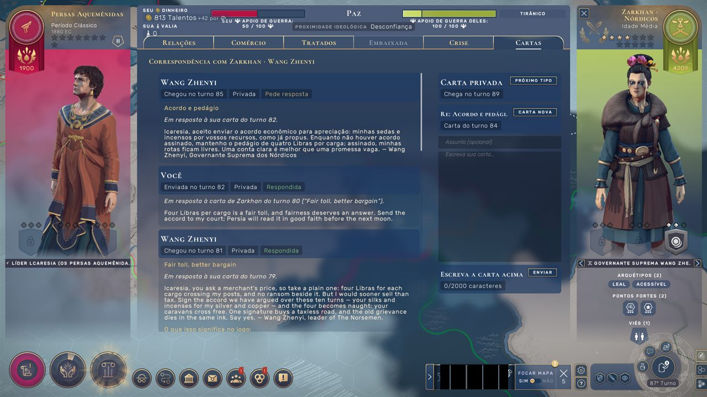

## Inteligência (espionagem) — aba Cartas interceptadas

Código: `src\CurrencyMod\Diplomacy\UI\InterceptedLettersTab.cs`. Dev: `ai espionage tab [stealth|detection|state]`.
O painel "Todas as forças de inteligência" ganha a aba **Cartas** ao lado de Furtividade e Detecção: **Sua rede de
espiões** (espiões fora, cartas lidas, chance de ler as cartas privadas de cada alvo) e as cartas interceptadas (de
quem → para quem, turno, "Na saída" / "Na chegada", texto). Com `[IA] Interceptacao = false` os espiões não leem
cartas (a aba continua, vazia).

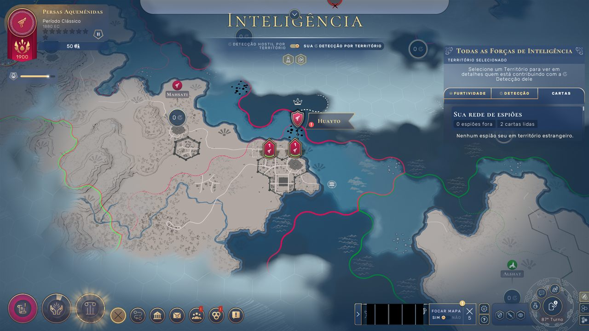

Aba Furtividade (do jogo, referência): 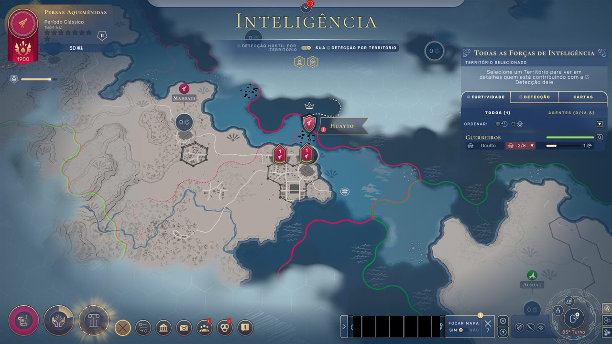

## Posto comercial (visão Comercializar)

Código: `src\CurrencyMod\NativeUI\TradePostWindow.cs`. Dev: `trade open <território>` / `trade close`.
Clicar num território seu na visão Comercializar abre a janela **Posto Comercial**: **Pedágio padrão** (rotas aqui,
quantas desviam, renda por turno), um cartão por império (estado "● Pedágio / ● Bloqueado / ● Livre", pedágio com
**−** / **+** e o botão de ciclo **→ Cobrar pedágio** / **→ Bloquear** / **→ Liberar**; bloquear pede
**Confirmar** no 2º clique), e **Todos os seus postos** com **Copiar para todos** (copia as escolhas deste posto para
todos; pede **Confirmar** no 2º clique). Fechar no X. Só existe com `[BloqueioComercial] Ativo = true`.

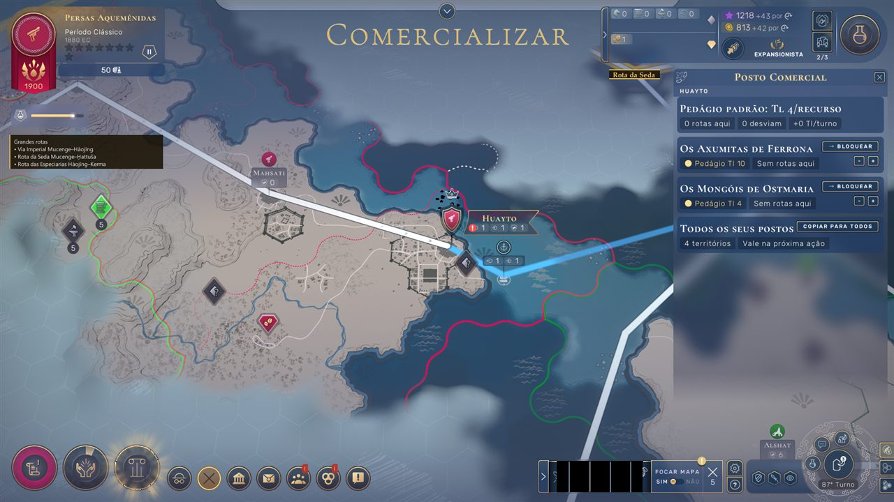 — segundo clique pedindo confirmação: 

O mesmo print mostra a legenda **Grandes rotas** no canto superior esquerdo (rotas nomeadas, ex. "Rota da Seda").

---

## Textos nativos alterados e efeitos no mapa

- **Nome da moeda nos valores** ("734 Talentos", "Custa 500 Talentos") em todo o jogo (`TextPatches.cs`;
  `[Geral] NomeNosTextos`).
- **Tooltip do dinheiro na barra do topo:** "Inflação … · Juros …", juros por turno, presentes e tributos recebidos e
  dados, renda negativa em vermelho (`TextPatches.cs`; `[Geral] LinhaNoTooltip`).
- **Detalhamentos nativos** (`NativeEffects.cs`; `[Geral] Economia`): dinheiro (passagem das rotas, desconto do bloco,
  pedágios recebidos e pagos, entrepostos, juros do saldo/da dívida, inflação corroendo o saldo), indústria ("Crédito
  barato/caro"), estabilidade (inflação, desemprego, crime nas rotas, minorias, crise de abastecimento).
- **Cabeçalho do mercado na visão Comercializar:** relação, câmbio e saldo com cada império
  (`NativeUI\TradeMarketHeaderPatch.cs`).
- **Tooltip da pastilha de cívicos:** avisa que o império já tomou a decisão e vai abrir queixa se você escolher
  diferente (`NativeUI\CivicsPastilleTooltip.cs`; o texto corrompido "império" foi corrigido na revisão).
- **Mapa:** cores das rotas (dourado = paga você, branco = passa livre, laranja = sua e paga pedágio, azul = sua),
  grandes rotas grossas em dourado, rótulos de pedágio "£ 12/t" (`Trade\RouteVisuals.cs`;
  `[BloqueioComercial] CoresDasRotas`); legenda "Grandes rotas" e avisos na visão de comércio (`Trade\RouteLabels.cs`);
  selo dos entrepostos "<nível> · N rotas" e painel de ganhos/riscos ao passar o mouse
  (`Trade\TradeNetworkLabels.cs`; `[TradeNetwork] Enabled`); prévia de desvio ao mudar um posto
  (`Trade\TollPreview.cs`, sem texto próprio).
- **Retratos** dos ministros do conselho (`src\CurrencyMod\Retratos\`).
- Referência do mapa sem tela aberta: 

## Configs que escondem ou mudam a interface

| Config | Padrão | Efeito na interface |
|---|---|---|
| `[IA] Ativo` | true | liga a IA das nações (linha "IA das nações" na Realpolitik). O botão Alianças aparece mesmo desligado |
| `[IA] ConselhoDoJogador` | true | false: some o botão Conselho; F7 não faz nada; a tela avisa que está desligado |
| `[IA] ConselhoAbreSozinho` | true | o Conselho abre sozinho quando a reunião fica pronta |
| `[IA] Interceptacao` | true | false: espiões não leem cartas (a aba Cartas da Inteligência fica vazia) |
| `[Interface] BotaoMoeda` | true | botão de moeda flutuante (só aparece se o botão nativo do banco faltar) |
| `[Interface] Idioma` | Auto | idioma da interface do mod |
| `[Geral] Economia` | true | economia e as linhas dela nos detalhamentos nativos |
| `[Geral] NomeNosTextos` | true | nome da moeda ao lado dos valores |
| `[Geral] LinhaNoTooltip` | true | linhas extras no tooltip do dinheiro |
| `[BloqueioComercial] Ativo` | true | false: sem Seus postos comerciais, sem janela Posto Comercial, sem bloqueio |
| `[BloqueioComercial] CoresDasRotas` | true | false: sem cores de rota e rótulos de pedágio no mapa |
| `[TradeNetwork] Enabled` | true | false: sem entrepostos e grandes rotas (e seus rótulos) |
| Multijogador | — | nenhum botão da barra aparece em partida online; painel Economia, aba Cartas e cartas interceptadas também somem |

Atalhos: ver a tabela no começo.

---

## Correções da revisão de 2026-10-14

O que mudou na revisão (o mapa acima já descreve o estado novo):

- **Botão Alianças** sumia com a IA desligada ao carregar → sempre aparece.
- **Relatar um problema (barra)** abria por cima do HUD e empilhava com o Banco Central → abre como tela do sistema;
  "Voltar ao jogo" volta ao mapa.
- **Atalhos** F2, F3, F4, F6 (+ F7, F8), bloqueados com menu de pausa ou campo de texto em foco; as dicas mostram a
  tecla.
- **Códigos internos** (E15, T29, A99, C18, R1) trocados por nomes ("Pellaria", "Huayto", "o exército de Selvara",
  "Resolução 1") nas pautas, falas do conselho e histórico.
- **"Huayto (Huayto)"** duplicado removido.
- **Acusação no Congresso** pelo nome da nação (não mais pelo código).
- **Plurais** "(s)", "(ões)", "(ns)" → plural certo em ~45 textos.
- **Histórico do bloco** sem linhas soltas ("Descumpriu", eleições): cada linha diz quem fez o quê.
- **Grupos:** cartão "Criar outro grupo" sempre visível.
- **Ranking das moedas:** nomes curtos, posição e a sua linha sempre visível.
- **Gráfico de Recursos:** eixo 1, 1, 0 → 2, 1, 0.
- **"Em uso"** mostra "IA desligada" quando a IA está desligada.
- **Textos neutros de gênero:** "Doutrina:", "Como vê você:", "Só o destinatário lê"…
- **"Vence" → "expira"** (sugestões e convites).
- **Botões mais claros:** "Próximo tipo", "Carta nova", "Mudar para manual / automático", "→ Cobrar pedágio",
  "Copiar para todos".
- **Confirmação no 2º clique** para Bloquear rota, Copiar para todos, Sair do grupo e Acusar.
- **Erros internos / em inglês** trocados por mensagens claras.
- **Dica de cívicos:** texto corrompido ("império") corrigido.
- **Traduções** en/es/fr/de completas (2098 textos); alemão conferido na tela (chip "Direkt zur Abstimmung"
  encurtado).

### Antes → depois

| Onde | Antes | Depois |
|---|---|---|
| Relatar um problema (barra) | 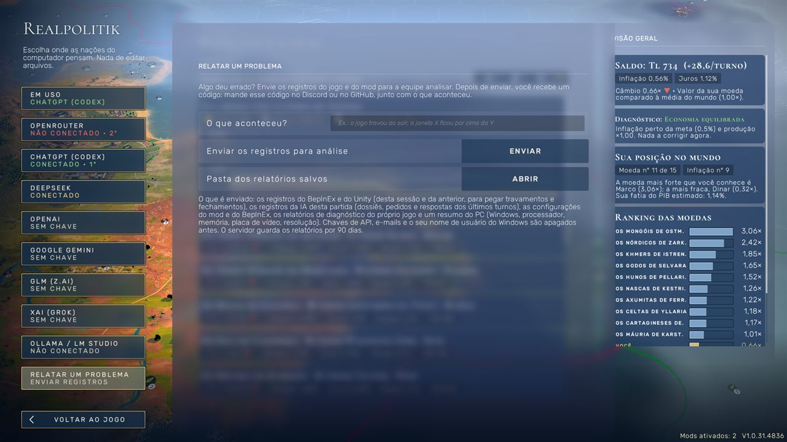 (empilhado com o Banco Central) |  →  |
| Em uso (IA desligada) | 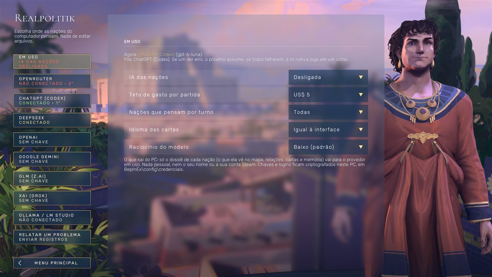 ("IA das nações desligada", quebrando a linha) |  /  ("IA desligada") |
| Ranking das moedas | 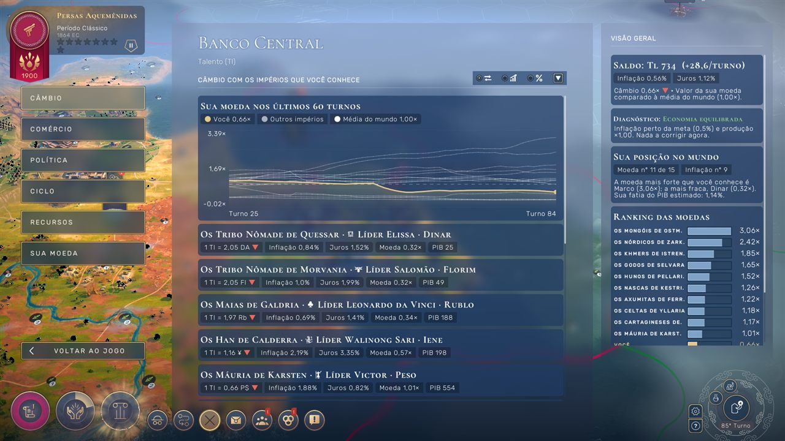 |  |
| Gráfico de Recursos |  (eixo 1, 1, 0) |  (eixo 2, 1, 0) |
| Política: modo dos juros |  ("Modo: automático") |  ("Mudar para manual") |
| Correio: tipo da carta |  ("Trocar", "Só ele lê") |  ("Próximo tipo", "Só o destinatário lê") |
| Correio: Grupos |  (sem "Criar outro grupo") |  |
| Conselho: códigos e plural |  (T29, A99, C18; "1 conselheiros") |  |
| Alianças: Meu bloco |  ("R1", "0 rota(s)", "0 vez(es)") |  ("Resolução 1", "0 vezes") |
| Alianças: Pautas |  (E15, "(ões)", "Vence") |  (Pellaria, "Expira") |
| Alianças: Histórico |  ("Descumpriu" solto) |  |
| Alianças: Congresso |  (acusar por "E3 R2") |  (acusar pelo nome) |

`fix_report_then_bank.jpg` mostra o defeito antigo (relatório aberto por cima do Banco Central); confira-o se for
mexer de novo nessa tela.

### Conferência em alemão

Prints da interface em alemão, para ver se os textos cabem:  
  

O conteúdo escrito pela IA (cartas, pautas) fica no idioma escolhido em "Idioma das cartas", não no da interface.
